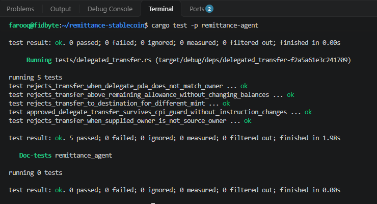

# Remittance Agent

A minimal Anchor program that executes Token-2022 transfers using a user's
explicitly approved delegate allowance. The delegate is a program-derived
address (PDA) scoped to the user's public key.

## How it works

1. The user derives the agent PDA from `[b"transfer-agent", user_pubkey]`.
2. The user directly approves that PDA as a delegate on a Token-2022 source
   account using `Approve` or `ApproveChecked`, choosing the allowance.
3. Anyone can call `execute_transfer`; the program signs the Token-2022
   `TransferChecked` CPI with the user's PDA. The source owner does not need
   to sign the execution transaction.
4. Token-2022 enforces the remaining delegate allowance. The user retains
   control of approval and can revoke it with a direct Token-2022 instruction.

The program does not store a separate allowance or recipient policy. A
delegated transfer can send tokens to any destination account for the same
mint, up to the amount approved by the owner.

## Compliance limitation: confidential balances

The related `remittance-stablecoin` program's `seize_public_balance` path can
move only a sanctioned account's public Token-2022 balance. If the holder moves
tokens into the confidential balance before the permanent delegate acts, that
public seizure path cannot reach those tokens: it does not decrypt or transfer
confidential balances. The current programs do not provide a corresponding
confidential-balance seizure or recovery path, so the public seizure may leave
some or all of the holder's value untouched. Do not treat a successful public
seizure as proof that the holder's full balance was recovered.

If sanctions policy requires control over confidential balances, that requires
a separately designed and reviewed confidential-control mechanism; it is not
provided by this agent or by `seize_public_balance`.

## CPI Guard

CPI Guard can be enabled by the account owner after the delegate approval.
This program's transfer path remains unchanged: the CPI authority is the
user-specific delegate PDA, not the token-account owner. The Token-2022 CPI
Guard permits delegated transfers while blocking owner-authorized transfers
through CPI. The LiteSVM lifecycle test approves the PDA, transfers once,
enables CPI Guard on the source account, then executes the same transfer
instruction again and verifies balances and remaining allowance.

## Program details

- **Program ID:** `2RxSzAKT8HVc3ynLrYPJh4PJVoYC9PsStGkMrBiutgAD`
- **Instruction:** `execute_transfer(amount)`
- **Token program:** Token-2022 only
- **PDA seed:** `[b"transfer-agent", owner_pubkey]`

## Build and test

Run from the repository root. The test setup builds the Anchor programs and a
Token-2022 SBF program with confidential-transfer zk-ops enabled:

```sh
anchor test
```

To run only this program's Rust tests after building the test programs:

```sh
./scripts/build-litesvm-test-programs.sh
cargo test -p remittance-agent
```


## Test results

The screenshot below shows the passing test run. It is stored next to `lib.rs`
in [`src/`](src/).



