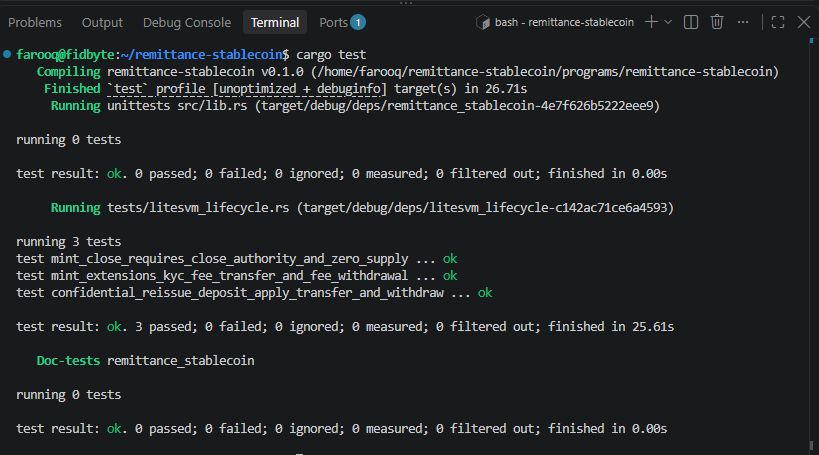

# Remittance Stablecoin

An Anchor program for issuing and managing a compliance-aware remittance token
on Solana. It uses Token-2022 extensions for transfer fees, mint metadata,
default-frozen token accounts, permanent delegation, and confidential transfers.

This program provides the on-chain operations; it does not provide a client
application, custody service, or KYC provider.

## Program details

- **Program ID:** `E8js5UVXNrdYmGeCCBKE2vdL1qK4XbjkaZ88TJDi19Wz`
- **Framework:** Anchor
- **Token standard:** SPL Token-2022
- **Rust edition:** 2021
- **Minimum Rust version:** 1.89.0

## Capabilities

### Mint setup

- `initialize_mint` creates a Token-2022 mint with transfer-fee configuration,
  on-mint metadata, a close authority, and frozen-by-default token accounts.
- `reissue_confidential_mint` creates a replacement mint with confidential
  transfer support and a permanent delegate. It does **not** migrate supply or
  token balances from another mint.

### Public token operations

- `transfer_checked_with_fee` transfers public balances with the current
  epoch's configured fee.
- `thaw_kyc_account` thaws an account after the freeze authority's approval;
  it does not change the mint's frozen-by-default setting.
- `seize_public_balance` lets the permanent delegate move a public balance.
  Confidential balances are not available to this operation.
- `collect_fees` withdraws transparent withheld fees from source accounts
  supplied as remaining writable accounts.
- `close_mint` closes a mint when Token-2022's close conditions are met.

### Confidential transfers

- `configure_confidential_account` sets up confidential-transfer settings for
  an existing token account using a verified public-key proof context. The
  token-account owner must sign.
- `approve_confidential_account` manually approves the configured account.
- `deposit_confidential` deposits public tokens into the account's confidential
  pending balance.
- `apply_pending_balance` moves pending credits into the available confidential
  balance.
- `confidential_transfer` transfers confidential tokens and fees using
  pre-verified proof contexts.
- `withdraw_confidential` applies pending credits and withdraws confidential
  tokens to the public balance.
- `harvest_confidential_fees` harvests confidential withheld fees from source
  accounts into the mint.
- `withdraw_confidential_fees` withdraws harvested confidential fees using a
  verified equality-proof context.

## Build and test

Run commands from the repository root. The LiteSVM integration tests require
the compiled program and a Token-2022 SBF program built with confidential
transfer zk-ops enabled. The configured Anchor test script prepares both:

```sh
cargo test
```

Alternatively, after preparing the test programs, run just this package's
Rust test suite:

```sh
./scripts/build-litesvm-test-programs.sh
cargo test 
```

The lifecycle tests cover mint extensions, KYC thawing, public transfer fees
and fee withdrawal, mint closure conditions, and confidential mint reissue,
deposit, transfer, and withdrawal.

## Test results

The screenshot below shows the passing test run. It is stored next to `lib.rs`
in [`src/`](src/).


